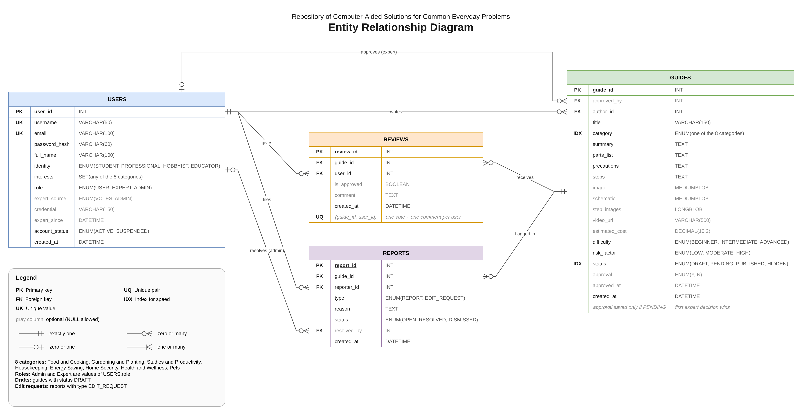

# Repository of Computer-Aided Solutions for Common Everyday Problems

A JavaFX desktop app where people share step-by-step DIY guides (Arduino, sensors and smart home builds) for everyday problems. Users vote and comment, high-risk guides wait for an expert, and admins moderate. All data lives in one TiDB Cloud (MySQL-compatible) database, so every laptop sees the same guides.

Software Design project · @author Luis Gabriel Santiago

## What you need

1. NetBeans with JDK 21 (JDK 17 also works if you change `maven.compiler.release` in `pom.xml` to 17).
2. Internet the first time you build. Maven downloads JavaFX, the MySQL driver, jBCrypt and JUnit by itself.
3. The free TiDB Cloud Starter database with `schema.sql` and `seed.sql` run in it (see below).

## Set up the database (once, by one member)

1. In TiDB Cloud, open your instance, click **Connect**, and copy the host and the user prefix (the part before `.root`).
2. Open `database/schema.sql` in MySQL Workbench, use Find and Replace to change every `YOUR_PREFIX` to your prefix, and run the whole file as `YOUR_PREFIX.root`.
3. Run `database/seed.sql` the same way. It adds 6 test accounts and 10 starter guides.

Already have a `cas_db` from before? Run `database/upgrade.sql` once. It adds the schematic, step photo and video columns.

## Run the app in NetBeans

1. **File > Open Project** and pick this folder.
2. Copy `db.properties.example` to `db.properties` (same folder). Set `db.host` to your TiDB host and replace `YOUR_PREFIX` in `db.user` with your prefix. `db.properties` is in `.gitignore`, so your real login is never uploaded.
3. Right-click the project > **Run**. The login window opens.
4. Right-click the project > **Test** to run the expert formula tests.

## Test accounts (from seed.sql)

| Username | Password | Role |
| --- | --- | --- |
| admin | Admin@2026 | Admin, sees the Admin Panel |
| prof_sample | Expert@2026 | Expert added by the admin, sees Expert Drafts |
| student_test | User@2026 | Student |
| pro_test | User@2026 | Professional |
| hobby_test | User@2026 | Hobbyist |
| educator_test | User@2026 | Educator |

You can also click **Create an account** or **Continue as Guest**.

## Sample data for demos (optional)

`database/sample_data.sql` adds 41 sample accounts (password `User@2026`, emails end in `@users.cas.local`), 16 more guides with YouTube build videos, about 300 votes and comments, and a few reports. Then run `database/sample_media.sql` for the wiring schematics and step pictures (10 MB, so in MySQL Workbench use **File > Run SQL Script** or open it and use **Run Script**). `database/remove_sample_data.sql` removes all of it again.

## How the code is organized

| Part | Files |
| --- | --- |
| Start | `Mavenproject2` (main), `CasApp` (the window) |
| Model classes (all the SQL) | `User`, `Guide`, `Review`, `Report` |
| Database connection and pool | `Database` (reads `db.properties`) |
| Navigation and login state | `Nav`, `Session` |
| FXML screens | `login.fxml`, `register.fxml`, `onboarding.fxml`, `shell.fxml`, `builder.fxml` and their controllers |
| Pages | `HomePage`, `BrowsePage`, `GuidePage`, `MyGuidesPage`, `ExpertDraftsPage`, `AdminPage`, `ProfilePage` |
| Shared UI | `Ui`, `Cards`, `Icons`, `BrandPanel`, `Categories`, `app.css` |
| Console demo | `BackendDemo` (expected output in `docs/sample_output.txt`) |
| Tests | `ExpertMathTest` |

## How the files match the board

| Diagram | Code |
| --- | --- |
| Class diagram (4 classes) | `User.java`, `Guide.java`, `Review.java`, `Report.java` |
| ERD (4 tables) | `users`, `guides`, `reviews`, `reports` in `database/schema.sql` (`docs/ERD_CAS.drawio`) |
| Sequence 1 Login and register | `LoginController`, `RegisterController`, `OnboardingController` |
| Sequence 2 Create guide | `BuilderController` (Save Draft, Submit) |
| Sequence 3 Review and report | `GuidePage` (Approve, Disapprove, Comment, Report, Request Edit) |
| Sequence 4 Expert approval | `ExpertDraftsPage` and the expert panel in `GuidePage` |
| Sequence 5 Admin | `AdminPage` |

## The expert rule

A user earns the expert badge when enough people from every identity group vote on their guides (stratified sampling) and the weighted approval rate is at least 80%. It is removed at 66.7% or lower.

| What | Formula |
| --- | --- |
| Votes needed (Slovin's formula, e = 0.05) | `n = ceil(N / (1 + N × 0.05²)) = ceil(400N / (400 + N))` |
| Each identity group's quota | `n_h = ceil(n × N_h / N)` |
| Weighted approval rate | `p = Σ (N_h / N) × (approvals_h / votes_h)` |

See `User.requiredVotes()`, `User.groupQuota()` and `User.tally()`.

## Other folders

| Folder | What is in it |
| --- | --- |
| `database/` | All SQL scripts |
| `docs/` | ERD (draw.io and picture) and the console demo's expected output |
| `tools/windows-installer/` | NSIS script for `Computer-Aided Solutions Setup.exe`, the portable launchers and the icon |
| `tools/sample-data/` | Python scripts that generate the sample users, guides, schematics and step pictures |
| `website/` | The download page |

## Credits

Icons are from [Lucide](https://lucide.dev) (ISC License), see `THIRD_PARTY_LICENSES.txt`.
